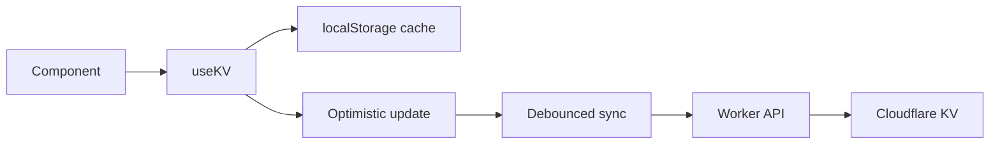

# HomeHub — Copilot Instructions

> **`AGENTS.md` is the source of truth** for stack, commands, and conventions. This file only adds
> code-level patterns for AI assistants. Product intent lives in `docs/PRD.md`; planned work is
> tracked in GitHub issues (see the pinned Roadmap issue).

## Stack at a glance

React 19 + TypeScript + Vite, Tailwind CSS 4 (OKLCH theme in `src/index.css`), Radix/shadcn UI,
`motion/react` for animation, Sonner for toasts, Lucide icons. Persistence is Cloudflare KV behind a
Worker (`workers/src/index.ts`), accessed through the `useKV` hook.

## State: use `useKV` for anything that must survive a refresh

```tsx
import { useKV } from '@/hooks/use-kv'
import { KV_KEYS } from '@/constants'
import type { Device } from '@/types'

const [devices, setDevices] = useKV<Device[]>(KV_KEYS.DEVICES, [])
setDevices(prev => prev.map(d => (d.id === id ? { ...d, enabled: !d.enabled } : d)))
```

Reads hit localStorage first, writes are optimistic and debounced (~500 ms) to the Worker. Do not use
`useState` for persistent data. Cross-component sharing is done through shared KV keys.



## Conventions

- **Imports**: use the `@/` alias. Types come from `@/types`; KV keys from `@/constants` (never
  hardcode key strings); icons from `@/lib/icons` only.
- **UI primitives**: `src/components/ui/*` are generated shadcn components (New York style, see
  `components.json`). Extend with wrappers or `className`; do not edit them directly.
- **Styling**: Tailwind theme tokens (`bg-primary`, `text-accent`), never hardcoded colors. Merge
  classes with `cn()` from `@/lib/utils`.
- **Mock data** belongs in `src/constants/mock-*.ts`, not inline in components.
- **Logging**: use `logger` from `@/lib/logger`, not raw `console.*`.
- **Typing**: no `any`; explicit types on function signatures; early returns over nesting.
- **Errors**: `react-error-boundary` with `ErrorFallback.tsx` at the root.
- **Navigation**: single-page, tab-based (no React Router); structure lives in `src/App.tsx`.
- **Diagrams** in docs use Mermaid, not ASCII art (palette in `docs/guides/ARCHITECTURE.md`).

## Mobile / iOS patterns

- Bottom sheets on mobile (<768px), centered dialogs on desktop.
- Respect safe areas (`safe-top`, `safe-bottom` utilities); touch targets at least 44×44px.
- Haptics through `useHaptic` (`@/hooks/use-haptic`) for gesture interactions.
- Honor reduced motion via `use-motion-preference`.
- Add `loading="lazy"` to below-the-fold images (especially camera snapshots).

## Where things live

| Area               | Location                                                                        |
| ------------------ | ------------------------------------------------------------------------------- |
| Types (with JSDoc) | `src/types/`                                                                    |
| KV keys, mock data | `src/constants/`                                                                |
| Hooks              | `src/hooks/` (`use-kv`, `use-device-control`, `use-mqtt-devices`, …)            |
| Device adapters    | `src/services/devices/` (Hue, Shelly, TP-Link, Arlo) and `src/services/device/` |
| Discovery          | `src/services/discovery/`                                                       |
| Automation engine  | `src/services/automation/` (scheduler, flow interpreter, geofence, conditions)  |
| KV Worker / proxy  | `workers/src/index.ts`, `workers/arlo-proxy/index.ts`                           |
| Dev simulators     | `scripts/virtual-device.js`, `scripts/http-virtual-device.js`                   |

## Docs

- Architecture: `docs/guides/ARCHITECTURE.md`, `docs/guides/SERVICE_LAYER_ARCHITECTURE.md`
- Standards: `docs/guides/BEST_PRACTICES.md`, `docs/guides/COMPONENT_PATTERNS.md`,
  `docs/guides/ERROR_HANDLING_PATTERNS.md`, `docs/guides/TESTING_GUIDE.md`
- Setup and deploy: `docs/guides/setup/SETUP_QUICKSTART.md`, `docs/deployment/CLOUDFLARE_DEPLOYMENT.md`
- Security policy: `SECURITY.md` (repo root)
